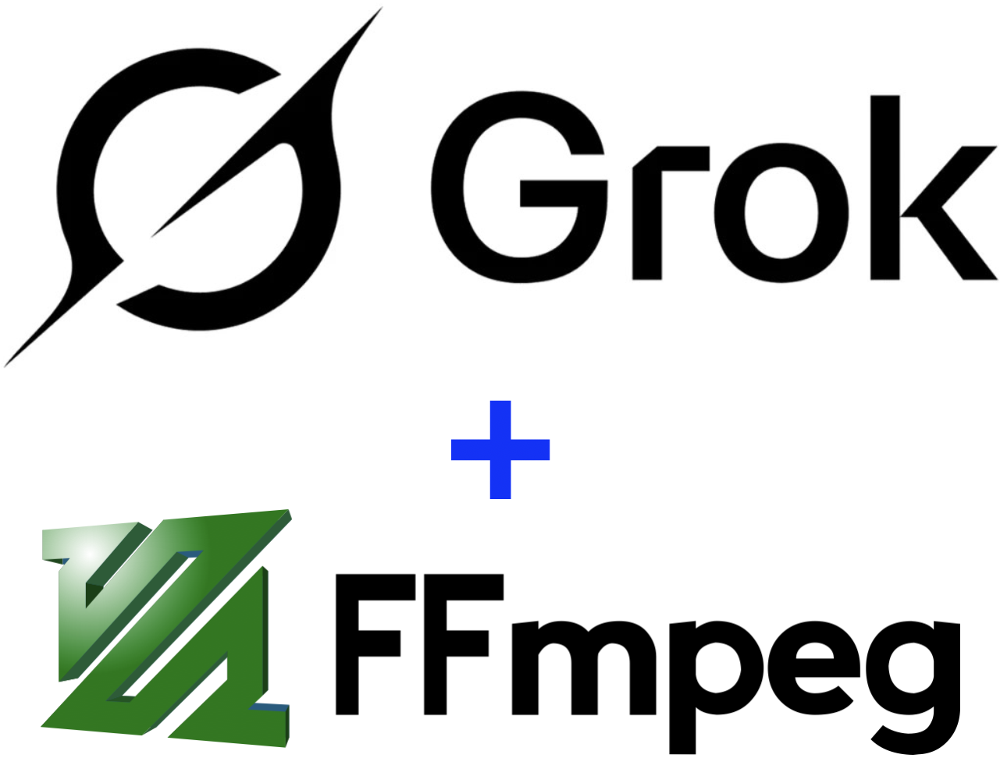

 

Consistent branding matters. Every video published by [ROIClear](https://ROIClear.com) must include the company logo before we publish it. 

The problem: We often record 30-second and 60-second videos on the fly. We rarely have time to power-on the video editor and apply the logo when we're moving quickly from asset to asset. We had to find a way to add the logo at the press of a button.

### FFmpeg

The FFmpeg utility offers one part of the solution. FFmpeg is a powerful command line utility for editing videos. FFmpeg can handle an editing task in rapid fashion.

Of course, being a command line tool, FFmpeg introduces another problem. Who has time to memorize all of the arcane flags and switches that are unique to this tool? 

Our solution: To wrap the FFmpeg utility in a specialized command of our own: `addlogo`.

### Grok's Role

And how did `Grok` get caught up in the mix? Here's how. Rather than taking the time to read the FFmpeg, bash, and .zshrc documentation, I told Grok what I wanted, created some constraints, and let Grok do the work. Grok returned with an `addlogo` utility that was mostly complete, except for a few small tweaks.

### addlogo

With `addlogo`, we add a logo to a video file as follows

```bash
$ addlogo video-filename.mov

```


And the `addlogo` utility returns a logo-stamped video file in the same directory. The new, logo-stamped file receives the name `video filename_logo.mov`.

This blog post covers the workflow so that you can create a similar utility tailored to your own needs.

### The One-Command Workflow

The goal was simple: type one command and get a finished file.

```bash
$ addlogo morning-update.mov
```

The output file appears in the same directory as `morning-update_logo.mov`, with the transparent ROIClear logo scaled to a reasonable size and placed in the top-right corner. Audio stays in sync. The original file is left untouched.

### What Gets Added to `.zshrc`

Here is the function currently living in the master branch of the `.dotfiles` repository. It expects a file named `logo.png` (the transparent version) to be present in the current working directory or on the path you choose to hard-code:

```bash
# Add ROIClear logo (top-right, reasonably small) to a video
# Usage: addlogo input.mov
# Output will be named input_logo.mov
addlogo() {
  if [[ $# -ne 1 ]]; then
    echo "Usage: addlogo input_file"
    return 1
  fi

  local input="$1"
  local logo="logo.png"   # ← change this path if needed

  if [[ ! -f "$input" ]]; then
    echo "Error: input file not found: $input"
    return 1
  fi

  if [[ ! -f "$logo" ]]; then
    echo "Error: logo file not found: $logo"
    echo "Place the transparent logo at that path (or edit the function)."
    return 1
  fi

  # Build output filename: insert _logo before the extension
  local dir="${input:h}"
  local base="${input:t}"
  local name="${base%.*}"
  local ext="${base##*.}"
  local output="${dir}/${name}_logo.${ext}"

  ffmpeg -i "$input" -i "$logo" \
    -filter_complex "[1:v]scale=iw*0.15:-1[logo];[0:v][logo]overlay=W-w-30:30" \
    -c:v libx264 -preset medium -crf 18 \
    -c:a aac -b:a 192k \
    -movflags +faststart \
    -pix_fmt yuv420p \
    "$output"

  echo "Done → $output"
}
```

After saving the file, reload the shell with `source ~/.zshrc`. From that moment the command is available in every new terminal window.

### What the Command Looks Like in Practice

```bash
$ addlogo AZMM-Friday-Morning.mov
```

FFmpeg runs, reports progress, and finishes with something close to:

```
frame=  450 fps=120 q=-1.0 Lsize=    8421kB time=00:00:15.00 bitrate=4598.4kbits/s speed=4x
Done → AZMM-Friday-Morning_logo.mov
```

The new file is ready to upload.

### `.zshrc` versus `.bashrc`

The function above is written for zsh (the default shell on modern macOS). The same logic works in bash with only minor syntax adjustments—primarily the parameter expansion used to build the output filename (`${input:h}`, `${input:t}`, etc.). On a system whose default shell is bash you would place an adapted version in `~/.bashrc` (or `~/.bash_profile`) instead. The FFmpeg command itself is identical.

### Will This Work on Linux?

Yes. FFmpeg is available through the package managers of every major Linux distro. Once it is installed, the same function (or a bash-compatible version of it) behaves the same way. The only practical differences are the installation command (`apt`, `dnf`, `pacman`, etc.) and the location of the shell startup file. The overlay logic does not change.

### Windows

The underlying FFmpeg command works on Windows as well. Official builds, installation notes, and PATH configuration details are available on the [FFmpeg site](https://ffmpeg.org/download.html). Most people either add the binary to their PATH or wrap the command in a small PowerShell or batch script that mirrors the logic shown above. The official documentation and the active FFmpeg community forums cover the platform-specific steps.

### Before and After

The video originally posted on [LinkedIn](https://www.linkedin.com/feed/update/urn:li:activity:7529568377426571264/) is a straightforward early-morning update. The version without the logo is clean but unbranded. After running `addlogo`, the transparent ROIClear mark sits in the top-right corner at a size that remains readable without covering the speaker or the background. The audio stays locked to the picture. The file is ready for [YouTube](https://www.youtube.com/@roiclear), [X](https://x.com/rayhightower), [LinkedIn](https://www.linkedin.com/in/rayhightower/), or [Facebook](https://www.facebook.com/rayhightower/) with no further editing.

### Closing the Loop

Now that we can add our branding in a single step, the decision to record becomes easier. More useful videos get made. The brand stays consistent across every channel. And the process stays small enough that it does not compete with the actual work of serving our investors.

Bottom line: Take the friction out of our processes so we can deliver for our investors. Everyone wins when that happens!
